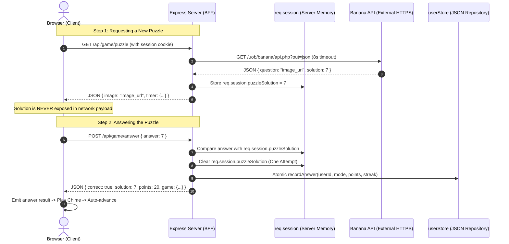

# Banana Game — CIS046-3 Software For Enterprise

> **Academic Coursework Notice:**  
> This project was developed for **CIS046-3 Software For Enterprise** university software assignment.  
> *Header Declaration: Generated with AI assistance for CIS046-3 Software For Enterprise.*

A modern, highly responsive browser puzzle game powered by Node.js, Express, and vanilla web standards (HTML5, CSS3, JavaScript ES2022). Players register a virtual identity, solve live banana math equations fetched from the external Banana API, and compete on mode-filtered leaderboards.

---

## Table of Contents
1. [Core Features](#core-features)
2. [Academic Themes & Architecture](#academic-themes--architecture)
3. [Prerequisites & Quickstart](#prerequisites--quickstart)
4. [Git Branching Strategy (Version Control)](#git-branching-strategy-version-control)
5. [Project Map](#project-map)
6. [Security & Interoperability Model](#security--interoperability-model)
7. [10-Minute Video Presentation Script](#10-minute-video-presentation-script)
8. [Known Limitations & Database Migration Plan](#known-limitations--database-migration-plan)

---

## Core Features

### 1. Gameplay Modes
- **Classic Mode:** Unlimited puzzles, 10 points per correct answer. Ideal for building a steady streak without time pressure.
- **Timed Mode:** Fast-paced 60-second speedrun. Consecutive correct answers raise a combo multiplier up to **8× points** (e.g., 10, 20, 30... up to 80 points per puzzle).
- **Survival Mode:** 3 lives. The time limit per puzzle shrinks as the player's run score climbs (from 18 seconds down to a minimum of 5 seconds). A single mistake or timeout deducts a life.

### 2. Ergonomics & Accessibility
- **Dual Input Controls:** On-screen number pad (0–9) and physical keyboard number keys (`0`–`9` and Numpad `0`–`9`).
- **Tactile Feedback:** Pressing keyboard numbers triggers visual `.active-press` highlights on the matching on-screen keypad button.
- **Seamless Flow & Auto-Advance:** Instant feedback reveals the solution, streak, and points, with smooth auto-advance (850ms in Timed, 1100ms in Survival, 1300ms in Classic) or immediate advance via <kbd>Enter</kbd> / <kbd>Space</kbd> / "Next Puzzle" button.
- **Preloaded Images:** Puzzle images are fully preloaded before removing the spinner and starting the countdown, ensuring players never lose timer seconds to network latency.
- **Web Audio API Synthesizer:** Pure synthesized audio chimes for correct answers, soft thuds for errors, and click feedback, with a persistent mute toggle (`localStorage`) and no external MP3 dependencies.
- **WCAG Accessibility:** High contrast text (>10:1 ratio), dual focus rings (`:focus-visible`), ARIA progress bar semantics, live regions (`aria-live="polite"`), and full `@media (prefers-reduced-motion: reduce)` support.

### 3. Virtual Identity & Player Profiles
- Secure user registration, login, and logout.
- Bcrypt password hashing (10 salt rounds) with constant-time dummy comparisons.
- Session fixation protection via `req.session.regenerate()` upon login and registration.
- Profile page showcasing lifetime summary cards (Peak High Score, Lifetime Points, Longest Streak, Total Played, Accuracy %) and a granular per-mode breakdown table.
- Filterable top-10 Leaderboard (Classic, Timed, Survival) with rank medals (🥇, 🥈, 🥉) and active player highlighting (`(You)`).

---

## Academic Themes & Architecture

The assignment requires addressing four key software enterprise themes. Here is how each is designed:

### 1. Version Control (`[THEME: VERSION CONTROL]`)
- Structured branching plan following feature-branch workflow.
- Clean `.gitignore` ensuring build artifacts (`node_modules/`), runtime databases (`data/users.json`), environment secrets (`.env`), and OS files are excluded.
- Small, single-purpose commits written in present imperative tense.

### 2. Event-Driven Programming (`[THEME: EVENT-DRIVEN PROGRAMMING]`)
- **Server:** Node.js asynchronous non-blocking event loop with Express middleware chain handling async I/O.
- **Client DOM Events:** Native event bindings for `click`, `keydown`, `submit`, `change`, and `hashchange`.
- **Custom Event Bus:** Lightweight `EventTarget` bus decoupling game logic:
  - `puzzle:loaded`: Fired when image preloader finishes; starts countdown timer.
  - `puzzle:error`: Fired on Banana API timeout or network failure.
  - `answer:submitted`: Fired when digit is inputted.
  - `answer:result`: Fired upon server verification; triggers animations and Web Audio synthesizer.
  - `timer:tick`: Fired during countdown to smoothly transform the progress bar.
  - `timer:ended`: Fired when round or puzzle deadline expires.
  - `game:over`: Fired when lives reach 0 or 60s expires.
  - `session:expired`: Fired on 401 unauthorized responses.

### 3. Interoperability (`[THEME: INTEROPERABILITY]`)
- Consumes external RESTful Banana API (`GET https://marcconrad.com/uob/banana/api.php?out=json`) over HTTPS.
- Node.js native `fetch` with an **8-second timeout** enforced via `AbortController`.
- **Zero Solution Leakage:** The server stores the secret `solution` in `req.session.puzzleSolution` and returns *only* the public image URL to the client. The client never receives the correct answer over the wire until after they have committed an answer.
- Graceful degradation: If the Banana API times out or is unreachable, the server returns HTTP 503 and the UI renders a friendly error card with a "Retry Puzzle" button.

### 4. Virtual Identity (`[THEME: VIRTUAL IDENTITY]`)
- Passwords are never stored in plaintext. They are salted and hashed using `bcryptjs` with 10 work rounds.
- Generic error messages (`"Invalid username or password."`) prevent username harvesting.
- Session hijacking and fixation mitigation:
  - `req.session.regenerate()` assigns a fresh session ID on login/register.
  - Cookie flags: `httpOnly: true` (blocks XSS cookie theft), `sameSite: "lax"` (mitigates CSRF), and conditional `secure: true` in production.
- Layered abstraction: Data layer (`src/userStore.js`) implements the Repository Pattern with thread-safe file atomic writes (`writeChain` queue), decoupling business logic from storage.

---

## Prerequisites & Quickstart

### Prerequisites
- **Node.js**: Version 18.0.0 or newer (tested on Node 18, 20, 22)
- **NPM**: Version 9.0.0 or newer
- An active internet connection for the Banana API

### Installation & Run

1. Clone or open the project directory:
   ```bash
   cd Banana-game
   ```

2. Install dependencies:
   ```bash
   npm install
   ```

3. Start the application:
   ```bash
   npm start
   ```
   *(For active development with auto-reloading, use `npm run dev`)*

4. Open your browser and navigate to:
   ```
   http://localhost:3000
   ```

If port 3000 is already in use, the server tries port 3001; if that is also unavailable, it selects an available port. Use the URL printed in the terminal.

### Optional Environment Variables
```bash
# Windows PowerShell example
$env:PORT="3000"
$env:SESSION_SECRET="your-strong-enterprise-secret-key-here"
$env:NODE_ENV="production" # marks session cookie as Secure (requires HTTPS)
npm start
```

---

## Git Branching Strategy (Version Control)

For the university submission, a feature-branch workflow is recommended:

```text
main (stable, production-ready release)
 │
 ├── feature/auth    (registration, login, logout, bcrypt, sessions, cookies)
 │    └── merged into main
 │
 ├── feature/game    (Banana API service, scoring rules, 3 game modes, timeout)
 │    └── merged into main
 │
 └── feature/ui      (HTML5 semantic layout, CSS3 responsive theme, client JS bus)
      └── merged into main
```

### Git Workflow Commands
```bash
# 1. Initialize and commit base structure on main
git init
git add .gitignore package.json
git commit -m "chore: initial project scaffolding and configuration"

# 2. Develop Authentication & Virtual Identity
git checkout -b feature/auth
git add src/auth.js src/userStore.js
git commit -m "feat(auth): implement bcrypt hashing, session cookies, and repository store"
git checkout main
git merge --no-ff feature/auth -m "merge: incorporate virtual identity and auth module"

# 3. Develop Interoperability & Game Engine
git checkout -b feature/game
git add src/bananaApi.js src/game.js
git commit -m "feat(game): integrate Banana API with 8s timeout and mode rules"
git checkout main
git merge --no-ff feature/game -m "merge: incorporate game rules and Banana API service"

# 4. Develop Accessible UI and Client Event Bus
git checkout -b feature/ui
git add public/index.html public/style.css public/app.js
git commit -m "feat(ui): implement responsive layout, EventTarget bus, and audio synthesis"
git checkout main
git merge --no-ff feature/ui -m "merge: incorporate client UI and event-driven architecture"

# Tag submission version
git tag -a v1.0.0 -m "Release v1.0.0 for CIS046-3 submission"
```

---

## Project Map

```text
Banana-game/
├── package.json              Dependencies (express, express-session, bcryptjs) & scripts
├── package-lock.json         Lockfile ensuring deterministic builds
├── .gitignore                Excludes node_modules, users.json, .env, and temp files
├── README.md                 Documentation, run guide, video script, and theme mapping
├── server.js                 Express server, session configuration, and REST routing
├── data/
│   ├── .gitkeep              Preserves data directory structure in Git
│   └── users.json            Runtime user database (gitignored)
├── src/
│   ├── auth.js               [VIRTUAL IDENTITY] Bcrypt hashing & credential validation
│   ├── bananaApi.js          [INTEROPERABILITY] HTTPS Banana API client with 8s timeout
│   ├── game.js               [EVENT-DRIVEN] Rules for Classic, Timed, and Survival modes
│   └── userStore.js          [REPOSITORY] Thread-safe atomic JSON file data access layer
└── public/
    ├── index.html            [UI] Semantic, accessible single-page layout (ARIA, skip link)
    ├── style.css             [DESIGN] Banana yellow & navy theme, responsive, motion-safe
    └── app.js                [CLIENT] EventTarget bus, Web Audio synthesizer, preloader
```

---

## Security & Interoperability Model



---

## 10-Minute Video Presentation Script

Use this outline during your assignment walkthrough video:

- **0:00 – 1:30 | Introduction & Live Demo**
  - Introduce yourself, the module code (*CIS046-3 Software For Enterprise*), and the Banana Game.
  - Demonstrate **Classic**, **Timed** (pointing out the combo multiplier), and **Survival** (pointing out shrinking time bar and lives).
  - Show keyboard input (<kbd>0</kbd>–<kbd>9</kbd>), tactile button feedback, and sound toggle.
- **1:30 – 3:30 | Theme 1: Interoperability (Banana API)**
  - Open `src/bananaApi.js`.
  - Explain the external call to `https://marcconrad.com/uob/banana/api.php?out=json`.
  - Highlight the `AbortController` 8-second timeout mechanism and input schema validation.
  - Open browser DevTools Network tab to prove the solution is **never sent** in `/api/game/puzzle`.
- **3:30 – 5:30 | Theme 2: Virtual Identity & Security**
  - Open `src/auth.js` and `server.js`.
  - Explain password hashing with `bcrypt.hash(password, 10)` and constant-time dummy checking.
  - Explain session cookies: `httpOnly` (XSS prevention), `sameSite: "lax"` (CSRF prevention), and `req.session.regenerate()` (fixation mitigation).
  - Show the Profile page displaying personal stats and mode breakdown.
- **5:30 – 7:00 | Theme 3: Event-Driven Architecture**
  - Open `public/app.js`.
  - Explain the custom `EventTarget` bus (`bus.dispatchEvent` and `bus.addEventListener`).
  - Trace how `puzzle:loaded` starts the timer and `answer:result` triggers the Web Audio synthesizer.
- **7:00 – 8:30 | Theme 4: Version Control & Repository Pattern**
  - Open `src/userStore.js`. Explain why data storage is separated into a repository layer to enable swapping for MongoDB or PostgreSQL without altering HTTP routes.
  - Explain the Git branch structure (`feature/auth`, `feature/game`, `feature/ui` merging into `main`).
  - Show `.gitignore` excluding `node_modules` and `users.json`.
- **8:30 – 10:00 | Accessibility, Error Handling & Summary**
  - Demonstrate the API retry screen by simulating an offline state.
  - Demonstrate accessibility: keyboard focus, screen-reader labels, and `prefers-reduced-motion`.
  - Conclude with project strengths and key learnings.

---

## Known Limitations & Database Migration Plan

### Known Limitations
1. **File-Based Storage:** `users.json` uses local file storage. While concurrency is guarded by an asynchronous promise chain (`writeChain`), it is intended for single-instance university evaluation, not multi-server distributed clustering.
2. **In-Memory Sessions:** Default `MemoryStore` is used for sessions. Restarting the Node server resets active sessions.
3. **No Email Recovery:** As a focused university project, features like password reset emails or 2FA are omitted.

### Swapping to a Database (Future Enterprise Migration)
Because data access is encapsulated in `src/userStore.js`, replacing the JSON file store with MongoDB or PostgreSQL requires updating only `src/userStore.js`:

```javascript
// Example MongoDB / Mongoose drop-in replacement for src/userStore.js:
const User = require("./models/User");

async function findByUsername(username) {
  return await User.findOne({ username: new RegExp("^" + username + "$", "i") }).lean();
}

async function findById(id) {
  return await User.findById(id).lean();
}

async function createUser({ username, passwordHash }) {
  return await User.create({ username, passwordHash, createdAt: new Date() });
}

async function recordAnswer(userId, mode, { correct, runScore, streak, points }) {
  // Update user stats with atomic MongoDB $inc and $max operators
  return await User.findByIdAndUpdate(userId, {
    $inc: {
      [`stats.${mode}.played`]: 1,
      [`stats.${mode}.correct`]: correct ? 1 : 0,
      [`stats.${mode}.totalScore`]: points || (correct ? 10 : 0)
    },
    $max: {
      [`stats.${mode}.highScore`]: runScore,
      [`stats.${mode}.bestStreak`]: streak
    }
  }, { new: true });
}
```
No Express routes, authentication middleware, or game rules would need to change.
# Banana-game
